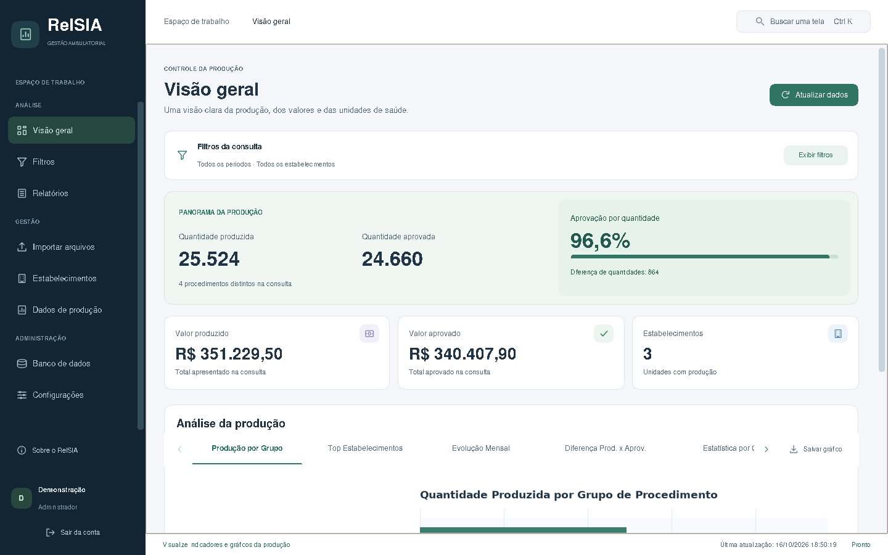

# RelSIA
Um sistema modelado em python com banco de dados local para visualizar dados inseridos no SIA (Sistema de Informações Ambulatorial). O SIA é onde faturamento de produções e procedimentos na área da saúde de um município.

## Interface renovada

Esta branch contém o Sistema SIA 2.21 com a identidade visual RelSIA: menu lateral agrupado, panorama da produção e aprovação, filtros recolhíveis, tabelas padronizadas e busca de telas. A interface continua usando Python e CustomTkinter.

### Executar no Windows

1. Baixe esta branch por **Code → Download ZIP** e extraia a pasta inteira.
2. Instale Python 3.11 ou superior e execute `install.bat`.
3. Execute `run.bat` e cadastre a senha do administrador no primeiro acesso.

Os ícones são desenhados no código; não é necessária uma pasta `assets`. O pacote não contém banco real nem senha predefinida.

Consulte [LEIA_PRIMEIRO.md](LEIA_PRIMEIRO.md) para orientações de dados, testes e compilação, e [VALIDACAO_WINDOWS.md](VALIDACAO_WINDOWS.md) para conferir o aplicativo no Windows.

### Nesta revisão

- Panorama com quantidades produzidas e aprovadas, percentual de aprovação e diferença de quantidades.
- Indicadores financeiros e de estabelecimentos em cartões com maior destaque.
- Resumo dos filtros aplicados e orientação quando a consulta não encontra produção.
- Busca de telas por **Ctrl+K**, com navegação por teclado e opções limitadas ao perfil conectado.
- Cabeçalhos, fontes e tabelas consistentes nas diferentes telas.
- Menu compacto com descrições dos ícones e adaptação dos cartões à largura da janela.

[Ver a busca de telas](docs/relsia-busca-telas.png) · [Ver os estabelecimentos](docs/relsia-estabelecimentos.png) · [Ver os relatórios](docs/relsia-relatorios.png)

### Validação

Foram aprovados 36 testes em Linux com Python 3.12 e sessão gráfica de testes, além do autoteste SQLite e da navegação dos dois perfis. A compilação do executável e a conferência de escala e fontes no Windows ainda devem ser realizadas no Windows.
